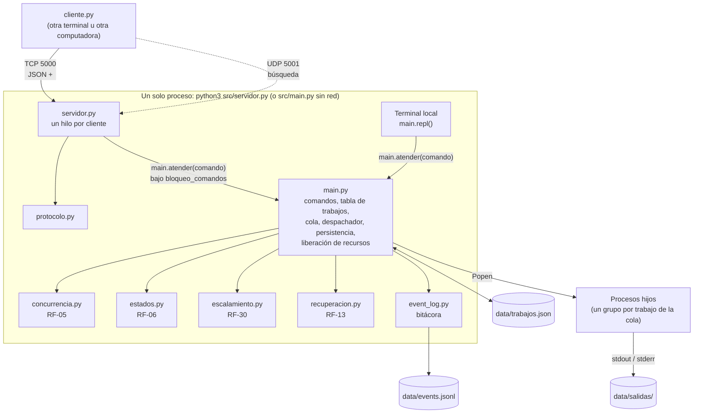
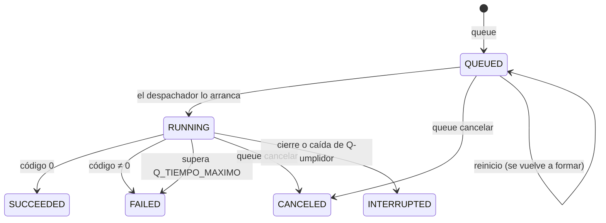
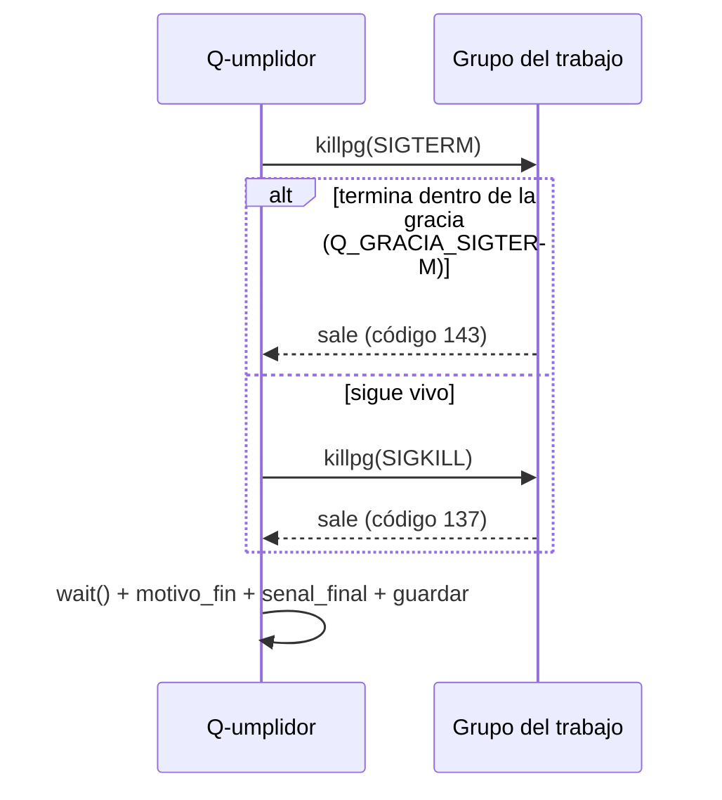

# Guía técnica — Q-umplidor

> **Estado:** versión final (Avance 03). Describe el código de `src/` en `main`. Si algo de aquí no coincide con el código, manda el código y hay que corregir este documento.
>
> **Responsable:** Oscar Aguilera. Reúne en un solo lugar lo que estaba repartido entre esta guía (Avance 02) y [ArquitecturaSistema.md](ArquitecturaSistema.md) (Ruy, Avance 02), que se conserva como registro de cómo se planeó la arquitectura.

Esta guía cubre los puntos de la "documentación técnica mínima" del estándar del cliente (doc. 04):

| Punto del doc. 04 | Sección |
|---|---|
| Arquitectura y responsabilidades | [2](#2-arquitectura-y-responsabilidades) |
| Modelo de procesos e IPC | [3](#3-modelo-de-procesos-e-ipc) |
| Estados del trabajo | [4](#4-estados-del-trabajo) |
| Protocolo de red | [5](#5-protocolo-de-red) |
| Formato persistente | [6](#6-formato-persistente) |
| Manejo de señales | [7](#7-manejo-de-señales) |
| Estrategia de errores | [8](#8-estrategia-de-errores) |
| Configuración | [9](#9-configuración) |
| Amenazas y límites conocidos | [10](#10-amenazas-y-límites-conocidos) |

Cómo instalar, construir y probar: [Construccion.md](Construccion.md). Cómo se usa: [guía de usuario](../user-guide/guia-de-usuario.md).

---

## 1. Propósito

Q-umplidor es un gestor de trabajos para Linux. Recibe comandos, ejecuta cada trabajo como un proceso del sistema operativo y permite consultar su estado, sus tiempos, su salida y su código, cancelarlo, limitar cuántos corren a la vez y conservar el historial entre reinicios. Se puede operar desde la terminal donde corre o desde otra computadora de la red local con `cliente.py`.

Todo está escrito en Python 3 con la biblioteca estándar (ADR-0001).

## 2. Arquitectura y responsabilidades



| Módulo | Responsabilidad | Funciones principales |
|---|---|---|
| `main.py` | Interpreta los comandos (`atender`), guarda la tabla de trabajos, lanza procesos, maneja la cola y el despachador, persiste, recupera y libera recursos al salir | `atender`, `repl`, `lanzar_trabajo`, `registrar_en_cola`, `despachar_cola`, `ejecutar_de_cola`, `finalizar_trabajo`, `guardar_trabajos`, `cargar_trabajos`, `liberar_recursos` |
| `concurrencia.py` | Lee, valida y cambia el límite de trabajos en ejecución; decide si hay lugar | `leer_limite_concurrencia`, `ControlConcurrencia.hay_espacio`, `atender_comando_limite` |
| `estados.py` | Traduce los estados internos a los del cliente, decide el estado final y calcula tiempos | `estado_cliente`, `estado_final`, `tiempo_espera`, `tiempo_ejecucion` |
| `escalamiento.py` | Detiene trabajos (SIGTERM → gracia → SIGKILL) y vigila el tiempo máximo | `leer_politica`, `terminar_con_escalamiento`, `iniciar_vigilante`, `mostrar_politica` |
| `recuperacion.py` | Al arrancar, reconoce y detiene los trabajos que siguieron vivos tras una caída | `huella_proceso`, `sigue_vivo`, `detener_huerfano`, `recuperar_trabajos` |
| `event_log.py` | Bitácora de eventos en `data/events.jsonl`, segura entre hilos | `EventLog.record`, `EventLog.read`, `format_entry` |
| `servidor.py` | Abre la red: acepta clientes, pide la clave, ejecuta sus comandos con `main.atender` y les devuelve lo que se imprimió | `iniciar`, `atender_cliente`, `ejecutar_remoto`, `responder_busquedas` |
| `protocolo.py` | Formato de los mensajes de red y cómo se leen y envían (servidor y cliente) | `LectorMensajes`, `enviar_mensaje`, `decodificar` |
| `cliente.py` | Cliente remoto: busca el servidor, pide la clave y funciona como la consola | `main`, `buscar_servidor`, `recibir` |
| `procesos.py` | Script de práctica; no forma parte del servicio ni lo importa nadie | — |

**Regla de dependencias.** `main.py` usa a `concurrencia`, `estados`, `escalamiento`, `recuperacion` y `event_log`, y ellos no importan a `main.py`: lo que necesitan del estado global (contar activos, listar los que corren) lo reciben como funciones. `servidor.py` importa a `main.py` y no al revés, así `python3 src/main.py` sigue funcionando sin red.

## 3. Modelo de procesos e IPC

### 3.1 Dos tipos de trabajo

Por historia del proyecto conviven dos tipos de trabajo, con numeración y comandos separados:

| | Trabajos "de afuera" (Avance 01) | Trabajos de la cola (Avance 02) |
|---|---|---|
| Se crean con | `sleep N &`, `ejecutar <prog> [args] &` | `queue <comando>` |
| IDs | Empiezan en 1 en cada sesión | Continúan entre sesiones |
| Se consultan con | `estado`, `listar`, `codigo`, `cancelar` | `queue`, `salida`, `errores`, `queue cancelar`, `eventos` |
| Proceso | `Popen` directo, sin shell; stdout y stderr a `DEVNULL` | `/bin/bash -c "<comando>"` (o Python para `sleep N`); stdout y stderr a `data/salidas/cola-<id>.out` / `.err` (RF-11) |
| Grupo de procesos propio | No | Sí (`start_new_session=True`, ADR-0007) |
| Cuenta para el límite (RF-05) | No | Sí |
| Persistencia y bitácora | No: viven mientras el programa está abierto | Sí: `trabajos.json` y `events.jsonl` |
| Cancelación | `terminate()`, 2 s, `kill()` | Escalamiento al grupo (sección 7) |

### 3.2 Cómo se crea un proceso de la cola

`ejecutar_de_cola()` abre los dos archivos de salida y llama a `Popen` con:
- `stdin=DEVNULL`: el trabajo no puede leer lo que se escribe en la consola.
- `stdout` y `stderr` = los archivos abiertos. El hijo recibe su propia copia de los descriptores y escribe directo en ellos. El padre los cierra al salir del `with`, así no se acumulan archivos abiertos.
- `start_new_session=True`: el trabajo es líder de su propio grupo. Una señal al grupo (`os.killpg`) alcanza también a los procesos que el trabajo lance (por ejemplo el `sleep` de `queue sleep 100; echo fin`). Además, un Ctrl+C en la consola ya no le llega directo.
- Variables `QUMPLIDOR_TRABAJO=cola-<id>` y `QUMPLIDOR_DATOS=<ruta de data>` en el entorno del hijo. Las heredan sus descendientes, y así `recursos` y el barrido final los encuentran en `/proc` aunque hayan escapado de su grupo.

Al arrancar se guarda la **huella** del proceso (pid, momento de creación según `/proc/<pid>/stat` y `boot_id`) para reconocerlo después de una caída sin confundirlo con otro proceso que reciba el mismo pid (ADR-0006).

### 3.3 Hilos

| Hilo | Cuántos | Qué hace |
|---|---|---|
| Principal | 1 | `repl()`: lee la terminal local y llama a `atender()` |
| Despachador (`despachar_cola`) | 1 | Saca IDs de la cola en orden de llegada (FIFO) mientras `hay_espacio()`; revisa cada 0.2 s o cuando lo despiertan |
| Ejecutor (`ejecutar_de_cola`) | 1 por trabajo de la cola en ejecución (≤ límite) | `Popen` → `wait()` → `finalizar_trabajo()` |
| Espera de afuera | 1 por trabajo `&` | `wait()` para anotar la hora real en que termina |
| Recolector (`recolectar_terminados`) | 1 | Cada 0.5 s recoge los trabajos de la cola que terminaron, para que no queden zombis |
| Vigilante (`iniciar_vigilante`) | 0 o 1 | Detiene los trabajos que superan `Q_TIEMPO_MAXIMO`; solo existe si es mayor que 0 |
| Red: aceptar (`escuchar_clientes`) | 1 | `accept()` y un hilo por cliente |
| Red: cliente (`atender_cliente`) | 1 por cliente conectado | Lee sus mensajes, ejecuta y responde |
| Red: búsqueda (`responder_busquedas`) | 1 | Contesta por UDP a `cliente.py` sin IP |

Todos son `daemon`: no impiden que el programa termine. El cierre ordenado lo hace `liberar_recursos()` (sección 7).

### 3.4 Sincronización

| Candado | Protege |
|---|---|
| `condicion_cola` (`Condition`) | `cola_ids`, `ids_arrancando` y la decisión "¿hay lugar? → sacar de la cola". `cancelar` en cola busca y retira el ID dentro de este mismo candado, así el despachador y la consola nunca deciden a la vez sobre el mismo trabajo ([INC-001](../incidents/INC-001.md)). |
| `bloqueo_trabajos` (`RLock`) | Los campos de cada trabajo. `finalizar_trabajo()` lo cierra una sola vez aunque dos hilos lo detecten terminado. |
| `bloqueo_guardado` (`Lock`) | La escritura de `trabajos.json`. |
| `bloqueo_comandos` (`Lock`) | Un comando a la vez entre la terminal local y los clientes de red. `sleep N` en primer plano no lo toma, para no detener a los demás mientras espera. |
| `EventLog._lock` | El contador `seq` y la escritura de cada línea de la bitácora. |
| `data/q-umplidor.lock` (`fcntl.flock`) | Que no haya dos Q-umplidor sobre la misma carpeta `data/`; si no, cada uno marcaría como interrumpidos los trabajos del otro. |

### 3.5 Comunicación entre procesos (IPC)

| Mecanismo | Entre | Para qué |
|---|---|---|
| Archivos (descriptores heredados) | Trabajo → Q-umplidor | stdout y stderr de cada trabajo de la cola |
| Código de salida (`wait`) | Trabajo → Q-umplidor | Resultado del trabajo; si murió por señal, `-N`, que se muestra como `128 + N` (143 = SIGTERM, 137 = SIGKILL) |
| Señales (`killpg`) | Q-umplidor → grupo del trabajo | Cancelar, tiempo máximo y cierre (sección 7) |
| Señales | Sistema → Q-umplidor | SIGTERM, SIGHUP y SIGINT inician el cierre ordenado |
| Entorno (`QUMPLIDOR_*`) y `/proc` | Q-umplidor ← sistema | Encontrar los procesos de cada trabajo (`recursos`, barrido final, recuperación) |
| Sockets TCP | `cliente.py` ↔ `servidor.py` | Comandos remotos (sección 5) |
| Socket UDP (difusión) | `cliente.py` → `servidor.py` | Encontrar el servidor en la red local |

## 4. Estados del trabajo

Se guardan en español (compatibilidad con historiales anteriores) y se muestran con los nombres del cliente (RF-06). Modelo completo: [ModeloDeEstados.md](ModeloDeEstados.md).



| Interno | Cliente | Cuándo |
|---|---|---|
| En cola | `QUEUED` | Aceptado, esperando lugar |
| En ejecución | `RUNNING` | El proceso sigue vivo |
| Terminado | `SUCCEEDED` | Terminó con código 0 |
| Falló (código N) / Falló (tiempo máximo excedido) | `FAILED` | Código distinto de 0, o lo detuvo el vigilante |
| Cancelado | `CANCELED` | Se pidió cancelar, en cola o en ejecución |
| Interrumpido | `INTERRUPTED` | Estaba corriendo cuando Q-umplidor se cerró o se cayó |

Los cuatro últimos son finales. Una sola función, `estados.estado_final()`, decide el estado final para todos los caminos (termina solo, cancelación, tiempo máximo). Tiempos: espera = inicio − encolado; ejecución = fin − inicio.

## 5. Protocolo de red

Responsables: Diego (servidor y cliente remoto, PR #157), Oscar (mensajes fragmentados y desconexiones, PR #160).

| Puerto | Protocolo | Uso |
|---|---|---|
| 5000 | TCP | Conexión de los clientes |
| 5001 | UDP | Búsqueda: el cliente envía `Q-UMPLIDOR?` por difusión y el servidor responde `{"puerto": 5000, "nombre": "<host>"}` |

### 5.1 Formato de los mensajes (RF-21, RNF-24)

Cada mensaje es **un objeto JSON en UTF-8 terminado en `\n`**, de 64 KiB como máximo (`protocolo.MAX_MENSAJE`).

| Sentido | Mensaje |
|---|---|
| cliente → servidor | `{"clave": "123456"}` y después `{"comando": "queue sleep 5"}` |
| servidor → cliente | `{"ok": true, "servidor": "<host>"}` / `{"ok": false, "mensaje": "clave incorrecta"}` |
| servidor → cliente | `{"salida": "ID: [1] agregado a la cola\n"}`: lo que el comando imprimió |
| servidor → cliente | `{"error": "motivo", "cerrar": true}`: aviso justo antes de que el servidor cierre la conexión |

Flujo: conectar → hasta 3 intentos de clave (con 1 s de espera tras cada error) → comandos y respuestas, uno a la vez → `salir` o cierre.

**Mensajes fragmentados.** TCP entrega un flujo de bytes, no mensajes. Un `recv()` puede traer medio mensaje, un mensaje y el principio del siguiente, o varios mensajes. `LectorMensajes` guarda los bytes en `pendiente`. Cada `leer()` busca el primer `\n`: si está, corta ahí, decodifica ese mensaje y deja el resto para la siguiente llamada; si no está, vuelve a llamar a `recv()`. Para enviar se usa `sendall()`, que repite el envío hasta mandar todos los bytes aunque el sistema operativo acepte solo una parte en cada llamada.

**Por qué no `makefile().readline()`.** La versión anterior usaba un archivo de texto sobre el socket: un byte que no fuera UTF-8 lanzaba `UnicodeDecodeError` fuera del `try` y mataba el hilo con `Traceback`, y una línea sin `\n` crecía en memoria sin límite. `LectorMensajes` trabaja con bytes, decodifica cada mensaje ya completo y corta si pasa de 64 KiB.

**Cómo se captura la salida.** Los comandos escriben con `print()`. `servidor.py` reemplaza `sys.stdout` por `SalidaPorHilo`: lo que imprime el hilo de un cliente se junta en un buffer de ese hilo y se manda como `salida`, y lo que imprimen los demás hilos sigue yendo a la terminal del servidor.

### 5.2 Desconexiones (RF-22, RF-28, RNF-25)

Ninguna falla de un cliente tumba el servidor ni a los demás clientes: cada uno tiene su hilo y `atender_cliente()` atrapa todo lo que pueda pasar en su conexión.

| Situación | Cómo se detecta | Qué pasa |
|---|---|---|
| El cliente escribe `salir` o cierra el programa | `recv()` devuelve 0 bytes → `ConexionCerrada` | Se cierra el socket y se registra `CLIENT_DISCONNECTED` |
| El cliente se va a mitad de un mensaje | `ConexionCerrada` con `incompletos > 0` | El pedazo se descarta (nunca llegó completo, no se ejecuta) y el motivo dice cuántos bytes |
| El cliente se va a mitad de un comando | El comando ya se está ejecutando; falla el envío de la respuesta | El trabajo sigue y queda registrado; se registra `RESPONSE_NOT_DELIVERED` con el comando |
| El cliente no manda nada durante `Q_INACTIVIDAD` segundos | `settimeout()` del socket → `socket.timeout` | Aviso `desconectado por inactividad` y cierre |
| La red se cae sin cerrar la conexión (cable, Wi-Fi) | `SO_KEEPALIVE` y el mismo timeout | El sistema operativo o el timeout terminan la conexión y se libera el hilo |
| Error de red (`ConnectionResetError`, `BrokenPipeError`) | `OSError` | Se cierra y se registra con el motivo |
| Se cierra el servidor con clientes conectados | El cliente recibe 0 bytes o `OSError` | El cliente avisa "Se perdió la conexión con el servidor". El servidor se puede volver a arrancar de inmediato gracias a `SO_REUSEADDR`; antes fallaba con `Address already in use` cerca de un minuto (`TIME_WAIT`) |

Siempre se ejecuta el `finally`: se cierra el socket y, si el cliente llegó a autenticarse, se registra `CLIENT_DISCONNECTED` con `cliente` (`ip:puerto`) y `motivo`. En el cliente, un mensaje con `"cerrar": true` se muestra como "El servidor cerró la conexión: <motivo>", y cualquier otra pérdida como "Se perdió la conexión con el servidor".

Pruebas: TC-028 a TC-037 (`verif/scripts/prueba_red.py`) y `verif/test-cases/test_protocolo.py`.

## 6. Formato persistente

```
data/
├── trabajos.json        # historial de la cola (escritura atómica)
├── trabajos.tmp         # solo existe durante un guardado
├── events.jsonl         # bitácora, una línea JSON por evento
├── q-umplidor.lock      # candado de una sola instancia
└── salidas/
    ├── cola-<id>.out    # stdout del trabajo de la cola <id>
    └── cola-<id>.err    # stderr
```

**`trabajos.json`** (ADR-0005): `{"siguiente_id": N, "trabajos": [...]}`. Solo guarda trabajos de la cola. Campos por trabajo: `id`, `comando`, `argumentos_cola`, `inicio`, `fin`, `estado`, `codigo`, `es_cola`, `segundos_solicitados`, `momento_encolado`, `motivo_fin`, `senal_final`, `huella` (pid, inicio del proceso, `boot_id`). No se guarda el objeto `Popen`.

- **Escritura atómica:** se escribe completo en `trabajos.tmp` y `os.replace()` lo cambia por el real en un solo paso. Si el programa muere a mitad, queda el archivo anterior completo, nunca uno a medias.
- **Validación al cargar:** IDs enteros, positivos y sin repetir, y contador válido. Si el archivo está dañado, el programa no arranca y dice por qué, en vez de trabajar con datos inválidos.

**`events.jsonl`**: una línea por evento, `{"seq", "ts" (UTC, ISO 8601), "event", "job_id", "details"}`. Solo se agregan líneas al final. Al leer se saltan las líneas dañadas (por ejemplo, una escritura cortada por un `kill -9`). Eventos: `SYSTEM_STARTED`, `SYSTEM_STOPPED`, `JOB_SUBMITTED`, `JOB_STARTED`, `JOB_FINISHED`, `JOB_CANCEL_REQUESTED`, `JOB_CANCELLED`, `JOB_REJECTED`, `JOB_INTERRUPTED`, `ORPHAN_FILES_REMOVED`, `OUTPUT_FILES_CLEARED`, `CLIENT_CONNECTED`, `CLIENT_DISCONNECTED` y `RESPONSE_NOT_DELIVERED`.

**Al arrancar** (ADR-0006):
1. `cargar_trabajos()` lee y valida el historial.
2. Los trabajos que estaban "En ejecución" se revisan con su huella. Si el proceso sigue vivo (Q-umplidor se cayó con `kill -9`), se detiene con escalamiento, y después se marcan como "Interrumpido" ([INC-002](../incidents/INC-002.md)).
3. Los que estaban "En cola" se vuelven a formar en orden.
4. Se borran los `.out`/`.err` que ya no pertenecen a ningún trabajo (`ORPHAN_FILES_REMOVED`) y se registra `SYSTEM_STARTED`.

## 7. Manejo de señales

**Señales que envía Q-umplidor (escalamiento, ADR-0007, RF-30).** Se usa la misma secuencia para `queue cancelar`, para el tiempo máximo y para el cierre:



Se envía al **grupo** y no solo al proceso para que no queden huérfanos los hijos del trabajo. `wait()` recolecta al proceso para que no quede como zombi.

**Señales que recibe Q-umplidor.**

| Señal | Origen típico | Qué hace |
|---|---|---|
| SIGTERM | `kill <pid>`, apagado del sistema | `cerrar_por_senal` → `sys.exit(143)` → cierre ordenado |
| SIGHUP | Se cerró la terminal | `cerrar_por_senal` → `sys.exit(129)` → cierre ordenado |
| SIGINT / EOF | Ctrl+C / Ctrl+D en la consola | Sale del `repl()` → cierre ordenado. Los trabajos de la cola no reciben el Ctrl+C porque están en otro grupo; los de afuera sí. |
| SIGKILL | `kill -9` | No se puede atrapar: los trabajos de la cola siguen vivos y se recuperan en el siguiente arranque (sección 6) |

**Cierre ordenado** (`liberar_recursos`, registrado con `atexit`):
1. Ignora SIGTERM, SIGHUP y SIGINT para que una segunda señal no corte la limpieza.
2. Detiene el recolector y cierra la cola: el despachador ya no arranca nada.
3. Termina cada trabajo activo (escalamiento para los de la cola, `terminate`/`kill` para los de afuera) y los marca como "Interrumpido".
4. Espera a los hilos que estaban arrancando un trabajo y vuelve a revisar.
5. **Barrido final:** busca en `/proc` procesos con `QUMPLIDOR_TRABAJO` que hayan escapado de su grupo, les manda SIGKILL y recolecta zombis con `waitpid(-1, WNOHANG)`.
6. Guarda `trabajos.json` y registra `SYSTEM_STOPPED`.

## 8. Estrategia de errores

Regla general: **un error de un trabajo, de un comando o de un cliente nunca detiene el servicio**; un error en los datos o en la configuración **detiene el arranque** con un mensaje claro, para no trabajar con algo inválido.

| Error | Dónde | Respuesta |
|---|---|---|
| Comando desconocido o con argumentos incorrectos | `atender` | Mensaje `<comando>: ...` con el uso correcto; la consola sigue |
| Programa inexistente en `ejecutar` | `lanzar_trabajo` → `OSError` | No se registra el trabajo ni consume ID; `JOB_REJECTED` |
| Comando inexistente en `queue` | El shell del trabajo | El trabajo queda `FAILED` (código 127) con el error en `errores <id>` |
| Cola llena (RF-25, RNF-29) | `registrar_en_cola` | Rechazo inmediato, sin registrar ni consumir ID; `JOB_REJECTED` |
| `queue` con el mismo comando que un trabajo de la cola todavía activo (RF-27) | `buscar_duplicado` | Semántica elegida: se acepta como trabajo nuevo y se avisa `ya hay un trabajo activo con el mismo comando ([id])`; la bitácora guarda `duplicado_de` |
| Dos cancelaciones del mismo trabajo (RF-26) | `cancelar` bajo `bloqueo_trabajos` | La primera cancela; la segunda responde `ya hay una cancelación en curso` o `ya estaba cancelado` |
| No se puede escribir `trabajos.json` | `guardar_trabajos` | Aviso en pantalla; el servicio sigue |
| `trabajos.json` dañado | `cargar_trabajos` | No arranca: `No se pudo cargar ...` |
| Variable de configuración inválida | `leer_*` | No arranca: `<VARIABLE> debe ser ...` |
| Otra instancia abierta | `bloquear_instancia` | No arranca: `Q-umplidor ya está abierto en otra terminal` |
| Puerto 5000 ocupado | `servidor.iniciar` | No arranca: `No se pudo abrir el puerto 5000 ...` |
| Mensaje de red inválido o demasiado grande, desconexión | `atender_cliente` | Sección 5 |
| Excepción inesperada al ejecutar un comando remoto | `ejecutar_remoto` | Se responde `error: ocurrió un problema inesperado ...`; el servidor sigue |

## 9. Configuración

Variables de entorno, leídas una vez al arrancar (por ejemplo `Q_LIMITE_CONCURRENCIA=3 python3 src/servidor.py`):

| Variable | Por defecto | Valores válidos | Qué controla | Dónde |
|---|---|---|---|---|
| `Q_LIMITE_CONCURRENCIA` | 2 | entero ≥ 1 | Trabajos de la cola en ejecución al mismo tiempo. También se cambia en caliente con `limite N` | `concurrencia.py`, ADR-0004 |
| `Q_CAPACIDAD_COLA` | 5 | entero ≥ 1 | Trabajos esperando antes de rechazar | `main.py` |
| `Q_GRACIA_SIGTERM` | 2 s | número ≥ 0.1 | Espera entre SIGTERM y SIGKILL | `escalamiento.py`, ADR-0007 |
| `Q_TIEMPO_MAXIMO` | 0 | número ≥ 0 (0 = sin límite) | Tiempo máximo de un trabajo de la cola | `escalamiento.py`, ADR-0007 |
| `Q_INACTIVIDAD` | 300 s | entero ≥ 1 | Segundos sin mensajes antes de desconectar a un cliente | `servidor.py` |

Fijo en el código: puerto TCP 5000, puerto UDP 5001, 3 intentos de clave, 64 KiB por mensaje, carpeta `data/` junto a `src/`.

## 10. Amenazas y límites conocidos

| Tema | Situación | Riesgo / qué haría falta |
|---|---|---|
| Ejecución de comandos | `queue` ejecuta lo que se le pida con `/bin/bash`, con los permisos del usuario que corre Q-umplidor. Es el propósito del sistema. | Quien tenga la clave puede ejecutar cualquier comando. No correr Q-umplidor como root. |
| Autenticación | Clave de 6 dígitos al azar (`secrets`), nueva en cada arranque, 3 intentos por conexión con 1 s de espera tras cada error. | Un atacante puede abrir muchas conexiones y probar claves; no hay bloqueo por IP. |
| Cifrado | TCP en texto plano: la clave y los comandos viajan sin cifrar. | Usar solo dentro de una LAN de confianza o una VPN, como pide el alcance. TLS (`ssl`) sería el siguiente paso. |
| Restricción de red (RF-20) | El servidor escucha en `0.0.0.0` y **no filtra por dirección**: acepta conexiones de cualquier IP que llegue al puerto. | Pendiente: lista de redes permitidas (por ejemplo, solo redes privadas con `ipaddress.is_private`) y rechazo registrado en la bitácora. |
| Un solo usuario | Todos los clientes comparten la misma cola y ven todos los trabajos. | No hay usuarios ni permisos por trabajo. |
| Conexiones simultáneas | Un hilo por cliente, sin máximo. | Muchas conexiones abiertas consumen hilos hasta que `Q_INACTIVIDAD` las cierra. RNF-29 pide rechazo explícito también al llegar al límite de clientes: pendiente. |
| Versión del protocolo (RNF-32) | Los mensajes no llevan número de versión. | Pendiente: un campo `"version"` en el primer mensaje y rechazo explícito si no coincide. |
| Trabajos de afuera | No se guardan, no tienen salida capturada ni grupo propio y no cuentan para el límite. | Un `ejecutar` que lance hijos puede dejarlos huérfanos al cancelarlo; usar `queue` para eso. |
| Salidas en disco | `.out`/`.err` crecen sin límite. | `queue clear` borra los de trabajos terminados. |
| Sistema operativo | Diseñado para Linux / WSL. En Windows arranca, pero sin señales ni `/proc` (usa Job Objects). | Las pruebas formales se corren en Linux / WSL. |
| `kill -9` a Q-umplidor | No hay cierre ordenado; los trabajos de afuera quedan sin dueño. | Los de la cola se recuperan al reiniciar (sección 6); los de afuera, no. |
| Scripts de prueba viejos | `prueba_cola.sh` (TC-005) y `prueba_avance02_ruy.py` (TC-020) no se han actualizado al cambio de `cancelar`/`queue cancelar`. | Ver [Construccion.md](Construccion.md#6-pruebas). |

## 11. Decisiones relacionadas

| ADR | Decisión | Estado |
|---|---|---|
| [ADR-0001](../decisions/ADR-0001.md) | Python 3, solo biblioteca estándar | Aceptado |
| [ADR-0002](../decisions/ADR-0002.md) | Pool fijo de hilos | Reemplazado por ADR-0004 |
| [ADR-0003](../decisions/ADR-0003.md) | Persistencia (propuesta abierta) | Resuelto por ADR-0005 |
| [ADR-0004](../decisions/ADR-0004.md) | Despachador con límite de concurrencia configurable | Aceptado |
| [ADR-0005](../decisions/ADR-0005.md) | JSON con escritura atómica | Aceptado |
| [ADR-0006](../decisions/ADR-0006.md) | Recuperación al reiniciar y cierre ordenado | Aceptado |
| [ADR-0007](../decisions/ADR-0007.md) | Cancelación con escalamiento SIGTERM → SIGKILL | Aceptado |

La red (TCP 5000, JSON por línea, clave de acceso) no tiene ADR propio todavía. Si el profesor lo pide, es la decisión con más alternativas: HTTP en vez de TCP, token fijo en vez de clave por arranque, TLS.

Incidentes: [INC-001](../incidents/INC-001.md) (cancelación en cola), [INC-002](../incidents/INC-002.md) (huérfanos tras `kill -9`).
