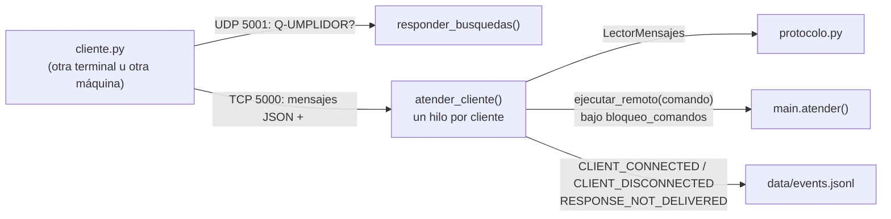

# Guía técnica — Arquitectura de Q-umplidor

> **Estado:** Avance 02, más la sección 10 (red) del Avance 03. Describe lo que hay en `src/main.py` en la rama `main`; la red está en `src/servidor.py`, `src/cliente.py` y `src/protocolo.py`. Lo que todavía no está integrado aparece en la sección 8 como pendiente. Si algo de aquí no coincide con el código, manda el código y hay que corregir este documento.

Responsable: Oscar Aguilera

## 1. Propósito

Q-umplidor es un gestor de trabajos para Linux. Recibe comandos en una consola interactiva, ejecuta cada trabajo como un proceso hijo del sistema operativo y permite consultar su estado, su salida y su código de salida, cancelarlo y conservar el historial entre reinicios.

## 2. Vista general

Todo el sistema vive hoy en un solo archivo, `src/main.py`, con biblioteca estándar de Python 3 (ADR-0001). Internamente se separa en cuatro partes:

```mermaid
flowchart TD
    U["Usuario (terminal)"] -->|escribe comandos| C["Consola<br/>ciclo while True + input()"]
    C -->|crea / consulta / cancela| T["Tabla de trabajos<br/>diccionario trabajos"]
    C -->|lanza| L["lanzar_trabajo()<br/>subprocess.Popen"]
    L -->|un proceso por trabajo| P["Procesos hijos"]
    P -->|stdout| O["data/salidas/&lt;id&gt;.out"]
    P -->|stderr| E["data/salidas/&lt;id&gt;.err"]
    T -->|guardar_trabajos()| J["data/trabajos.json"]
    J -->|cargar_trabajos() al iniciar| T
```

## 3. Componentes

| Componente | Dónde está | Qué hace |
|---|---|---|
| Consola | Ciclo `while True` al final de `main.py` | Muestra el prompt `Q-umplidor>`, separa el comando en palabras y llama a la parte que corresponde. Un comando inválido solo imprime un aviso. |
| Tabla de trabajos | Diccionario global `trabajos` y contador `siguiente_id` | Guarda por ID: proceso, comando, inicio, fin, estado, código y si se canceló. |
| Lanzamiento | `lanzar_trabajo()` y `registrar_trabajo()` | Crea el proceso hijo con su stdout y stderr redirigidos a archivos, y lo agrega a la tabla. |
| Supervisión | `actualizar_trabajo()` / `estado_trabajo()` | Llama `poll()` al proceso. Si ya terminó, guarda código y hora de fin, decide el estado final y lo persiste. |
| Persistencia | `guardar_trabajos()` / `cargar_trabajos()` | Escribe y lee `data/trabajos.json`. |
| Consulta de salidas | `mostrar_archivo()` | Lee el archivo `.out` o `.err` de un trabajo. |

## 4. Comandos

| Comando | Qué hace internamente |
|---|---|
| `sleep N` | `time.sleep(N)` en el mismo proceso (primer plano). |
| `sleep N &` | Lanza `python3 -c "import time; time.sleep(N)"` como hijo. |
| `ejecutar <programa> [args] &` | Separa los argumentos con `shlex.split` y lanza el programa sin shell. |
| `estado <id>` / `listar` | Actualizan cada trabajo con `poll()` y muestran estado y tiempo. |
| `codigo <id>` | Muestra el código guardado. Si murió por señal, lo muestra como Bash (`128 + señal`, por ejemplo 143 para SIGTERM). |
| `salida <id>` / `errores <id>` | Muestran `data/salidas/<id>.out` o `.err`. |
| `cancelar <id>` | SIGTERM, espera hasta 2 s, SIGKILL si no terminó, y `wait()`. |

## 5. Procesos, salidas y recursos

**Un proceso por trabajo.** Cada trabajo corre en su propio proceso (`subprocess.Popen`), no en un hilo. Así corren en paralelo de verdad, se pueden detener con señales y si uno falla no tumba la consola.

**stdout y stderr separados (RF-11).** `lanzar_trabajo()` abre dos archivos por trabajo y se los da a `Popen` como `stdout` y `stderr`. El hijo escribe directo en ellos, aunque la consola esté esperando otro comando, y la salida se puede consultar aunque Q-umplidor se reinicie.

**Descriptores de archivo.** El hijo recibe su propia copia de los descriptores. El padre abre los archivos dentro de un `with`, así que los cierra en cuanto el hijo arrancó y no se acumulan archivos abiertos.

**Entrada estándar.** Los trabajos reciben `stdin=DEVNULL`, para que no puedan leer lo que el usuario escribe en la consola.

**Programa inexistente.** Si `Popen` lanza `OSError`, se borran los dos archivos recién creados, se muestra el error y no se registra el trabajo ni se consume un ID.

**Recolección de hijos (zombis).** El código de salida de un hijo se lee con `poll()` cuando alguien consulta (`estado`, `listar`, `codigo`, `cancelar`) y con `wait()` al cancelar. Hasta esa consulta, un hijo que terminó solo queda como zombi (`Z` en `ps`). Ver pendientes.

## 6. Estados

| Estado en el código | Cuándo |
|---|---|
| En ejecución | El proceso sigue vivo (`poll()` devuelve `None`). |
| Terminado | Terminó con código 0. |
| Falló (código N) | Terminó con código distinto de 0 y no fue cancelado. |
| En cola | Registrado con `queue`, esperando turno; todavía no tiene proceso (`inicio` = `None`). |
| Cancelado | Se pidió `cancelar`, en ejecución o en cola. |
| Interrumpido | Estaba en ejecución cuando Q-umplidor se cerró o se reinició. |

El modelo completo (con `QUEUED`) está en [ModeloDeEstados.md](ModeloDeEstados.md). El cliente pide como mínimo `QUEUED`, `RUNNING`, `SUCCEEDED`, `FAILED` y `CANCELED` (RF-06); los nombres en español del código deben quedar mapeados a esos.

## 6.1 Cola de trabajos

- **Estructura:** `cola_ids` (un `deque` con los IDs en espera) protegida por `condicion_cola` (`threading.Condition`).
- **Hilo de la cola:** `despachar_cola()` corre en un hilo aparte. Espera en la condición, saca el siguiente ID en orden de llegada mientras haya lugar según el límite de concurrencia (RF-05) y lanza un hilo `ejecutar_de_cola()` por trabajo. Con `Q_LIMITE_CONCURRENCIA=1` los trabajos corren de uno en uno.
- **Capacidad (RF-25, RNF-29):** `CAPACIDAD_COLA` se lee de la variable de entorno `Q_CAPACIDAD_COLA` (por defecto 5, mínimo 1). Si al encolar ya hay esa cantidad esperando, `registrar_en_cola()` rechaza de inmediato: no registra, no consume ID y no bloquea. Un valor inválido detiene el arranque con un mensaje.
- **Cancelar en cola (RF-10):** `cancelar` busca el ID en `cola_ids` **dentro de `condicion_cola`**, el mismo candado que usa el hilo. Si lo encuentra, lo retira y lo marca "Cancelado" sin que llegue a arrancar. Así el hilo y la consola nunca deciden sobre el mismo trabajo al mismo tiempo. Si el hilo ya lo tomó pero aún no tiene proceso, se avisa que está arrancando. Ver [INC-001](../incidents/INC-001.md). `queue cancelar <id>` se traduce a `cancelar <id>` antes de interpretar el comando; sin eso, `queue` lo formaba como un comando de bash inexistente.
- **Tiempo:** `tiempo_trabajo()` devuelve 0 para trabajos sin `inicio` (en cola o cancelados antes de arrancar).

## 7. Persistencia y recuperación

- **Formato:** `data/trabajos.json` con `siguiente_id` y la lista de trabajos (sin el objeto `Popen`, que no se puede guardar).
- **Escritura atómica:** se escribe en `trabajos.tmp` y luego `os.replace()` lo cambia por el archivo real. Si el programa muere a mitad, queda el archivo anterior completo, nunca uno a medias.
- **Al arrancar:** `cargar_trabajos()` valida IDs (enteros, positivos, sin repetir) y el contador. Si el archivo está dañado, el programa se detiene con un mensaje en vez de arrancar con datos inválidos.
- **Recuperación:** los trabajos que estaban "En ejecución" pasan a "Interrumpido", porque sus procesos ya no pertenecen a esta sesión. Los que estaban "En cola" se vuelven a formar y se ejecutan.
- **Al salir normalmente:** los trabajos activos se terminan (SIGTERM → SIGKILL), se marcan como "Interrumpido" y se guarda el archivo.
- **Salidas:** los archivos de `data/salidas/` no se borran al reiniciar, por eso `salida` y `errores` siguen funcionando con trabajos anteriores.

La decisión real es JSON con escritura atómica, no SQLite: el ADR-0003 debe actualizarse para reflejarlo.

## 8. Pendientes del Avance 02

| Tema | Requisito | Responsable |
|---|---|---|
| Cola de trabajos | RF-03 | Diego — implementada (PR #130) |
| Límite configurable de concurrencia | RF-05 | Ruy |
| Estados y tiempos (nombres del cliente) | RF-06 | Ruy |
| Escalamiento documentado de la cancelación | RF-30 | Ruy |
| Cancelación de trabajos en cola | RF-10 | Oscar — implementada (PR #133, TC-005) |
| Rechazo explícito con cola llena | RF-25, RNF-29 | Oscar — implementado (PR #133, TC-016) |
| Bitácora de eventos | — | Marlene |
| Solicitudes concurrentes o duplicadas | RF-26 | Marlene |
| Liberación de recursos (recolectar hijos sin esperar una consulta) | — | Marlene |

La cola hoy abre sus propios archivos de salida en `ejecutar_de_cola()` en lugar de llamar a `lanzar_trabajo()`; conviene unificarlo para que haya un solo punto donde se lanzan procesos.

## 9. Decisiones relacionadas

| ADR | Tema |
|---|---|
| [ADR-0001](../decisions/ADR-0001.md) | Python 3 con biblioteca estándar |
| [ADR-0002](../decisions/ADR-0002.md) | Concurrencia: un proceso por trabajo, cola con pool de hilos |
| [ADR-0003](../decisions/ADR-0003.md) | Persistencia |

## 10. Red: servidor, cliente y protocolo

Responsables: Diego (servidor y cliente remoto, PR #157), Oscar (mensajes fragmentados y desconexiones).



| Archivo | Qué hace |
|---|---|
| `src/servidor.py` | Arranca la consola de `main.py` y además escucha en TCP 5000. Genera una clave de 6 dígitos al iniciar (3 intentos por conexión). Atiende a cada cliente en su propio hilo y ejecuta sus comandos con `main.atender()`, capturando lo que imprime (`SalidaPorHilo`). Responde búsquedas por UDP 5001. |
| `src/cliente.py` | `python3 src/cliente.py [ip]`. Sin IP busca el servidor en la red local por UDP. Pide la clave y luego funciona como la consola, pero remota. |
| `src/protocolo.py` | Formato de los mensajes y cómo se leen y envían. Lo usan los dos lados. |

### 10.1 Formato de los mensajes (RF-21)

Cada mensaje es **un objeto JSON en UTF-8 terminado en `\n`**, de 64 KiB como máximo (`MAX_MENSAJE`).

| Sentido | Mensaje |
|---|---|
| cliente → servidor | `{"clave": "123456"}` y después `{"comando": "queue sleep 5"}` |
| servidor → cliente | `{"ok": true, ...}` / `{"ok": false, "mensaje": "clave incorrecta"}` |
| servidor → cliente | `{"salida": "ID: [1] agregado a la cola\n"}` |
| servidor → cliente | `{"error": "motivo", "cerrar": true}`: aviso justo antes de que el servidor cierre la conexión |

**Mensajes fragmentados.** TCP entrega un flujo de bytes, no mensajes. Un `recv()` puede traer medio mensaje, un mensaje y el principio del siguiente, o varios mensajes. `LectorMensajes` guarda los bytes en `pendiente`. Cada `leer()` busca el primer `\n`: si está, corta ahí, decodifica ese mensaje y deja el resto para la siguiente llamada; si no está, vuelve a llamar a `recv()`. Para enviar se usa `sendall()`, que repite el envío hasta mandar todos los bytes aunque el sistema operativo acepte solo una parte en cada llamada.

**Por qué no `makefile().readline()`.** La versión anterior usaba un archivo de texto sobre el socket: un byte que no fuera UTF-8 lanzaba `UnicodeDecodeError` fuera del `try` y mataba el hilo con `Traceback`, y una línea sin `\n` crecía en memoria sin límite. `LectorMensajes` trabaja con bytes, decodifica cada mensaje ya completo y corta si pasa de 64 KiB.

| Error en un mensaje | Qué hace el servidor |
|---|---|
| No es UTF-8, no es JSON o no es un objeto (`MensajeInvalido`) | Responde `error: petición no válida (...)` y la conexión sigue |
| No trae `"comando"` | Responde un error y la conexión sigue |
| Más de 64 KiB sin `\n` (`MensajeDemasiadoGrande`) | Manda `{"error": ..., "cerrar": true}` y cierra solo esa conexión |

### 10.2 Desconexiones (RF-22, RF-28)

Ninguna falla de un cliente tumba el servidor ni a los demás clientes: cada uno tiene su hilo y `atender_cliente()` atrapa todo lo que pueda pasar en su conexión.

| Situación | Cómo se detecta | Qué pasa |
|---|---|---|
| El cliente escribe `salir` o cierra el programa | `recv()` devuelve 0 bytes → `ConexionCerrada` | Se cierra el socket y se registra `CLIENT_DISCONNECTED` |
| El cliente se va a mitad de un mensaje | `ConexionCerrada` con `incompletos > 0` | El pedazo se descarta (nunca llegó completo, no se ejecuta) y el motivo dice cuántos bytes |
| El cliente se va a mitad de un comando | El comando ya se está ejecutando; falla el envío de la respuesta | El trabajo sigue y queda registrado; se registra `RESPONSE_NOT_DELIVERED` con el comando |
| El cliente no manda nada durante `Q_INACTIVIDAD` segundos | `settimeout()` del socket → `TimeoutError` | Aviso `desconectado por inactividad` y cierre. Por defecto 300 s; un valor que no sea entero ≥ 1 detiene el arranque |
| La red se cae sin cerrar la conexión (cable, Wi-Fi) | `SO_KEEPALIVE` y el mismo timeout | El sistema operativo o el timeout terminan la conexión y se libera el hilo |
| Error de red (`ConnectionResetError`, `BrokenPipeError`) | `OSError` | Se cierra y se registra con el motivo |
| Se cierra el servidor con clientes conectados | El cliente recibe 0 bytes o `OSError` | El cliente avisa "Se perdió la conexión con el servidor". El servidor se puede volver a arrancar de inmediato gracias a `SO_REUSEADDR`; antes fallaba con `Address already in use` cerca de un minuto (`TIME_WAIT`) |

Siempre se ejecuta el `finally`: se cierra el socket y, si el cliente llegó a autenticarse, se registra `CLIENT_DISCONNECTED` con `cliente` (`ip:puerto`) y `motivo`. Con `eventos` se puede ver cuándo entró y salió cada cliente y por qué.

En el cliente, un mensaje con `"cerrar": true` se muestra como "El servidor cerró la conexión: <motivo>", y cualquier otra pérdida como "Se perdió la conexión con el servidor"; en los dos casos indica cómo reconectarse.

### 10.3 Configuración y verificación

| Variable | Por defecto | Para qué |
|---|---|---|
| `Q_INACTIVIDAD` | `300` | Segundos que una conexión puede estar callada antes de cerrarla |

Pruebas: `python3 verif/scripts/prueba_red.py` (TC-028 a TC-037, ver [casos de prueba](../../verif/test-cases/casos-de-prueba.md)).
