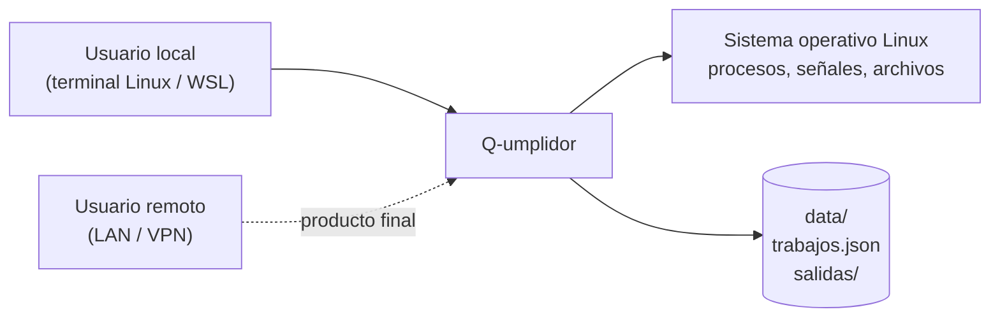
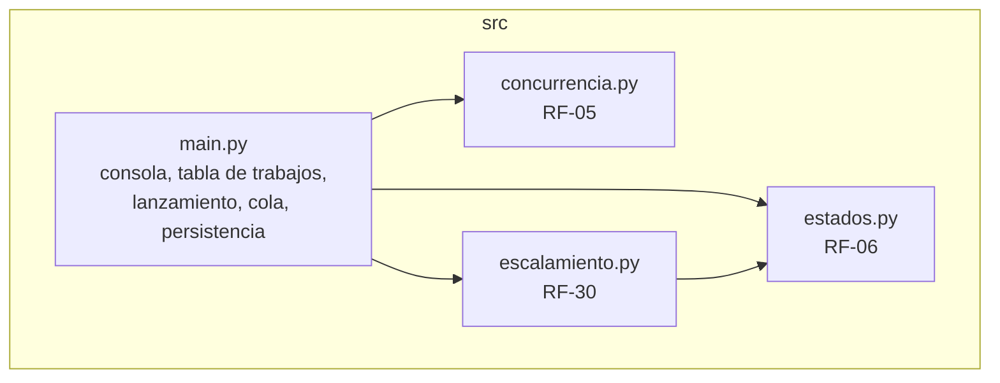
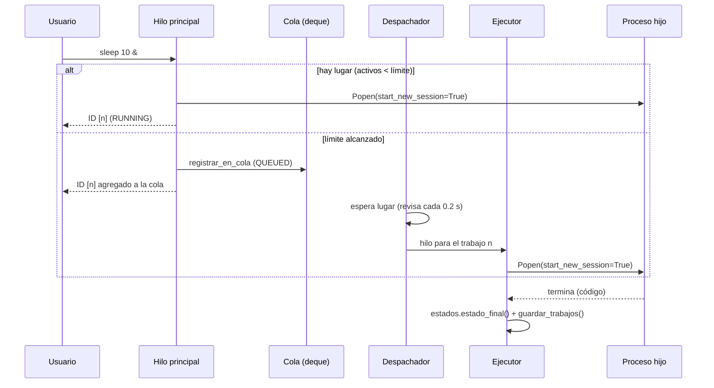
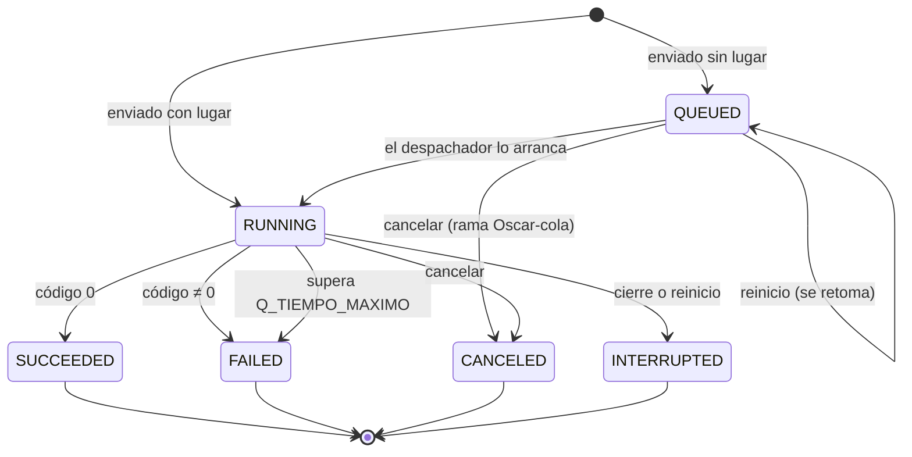
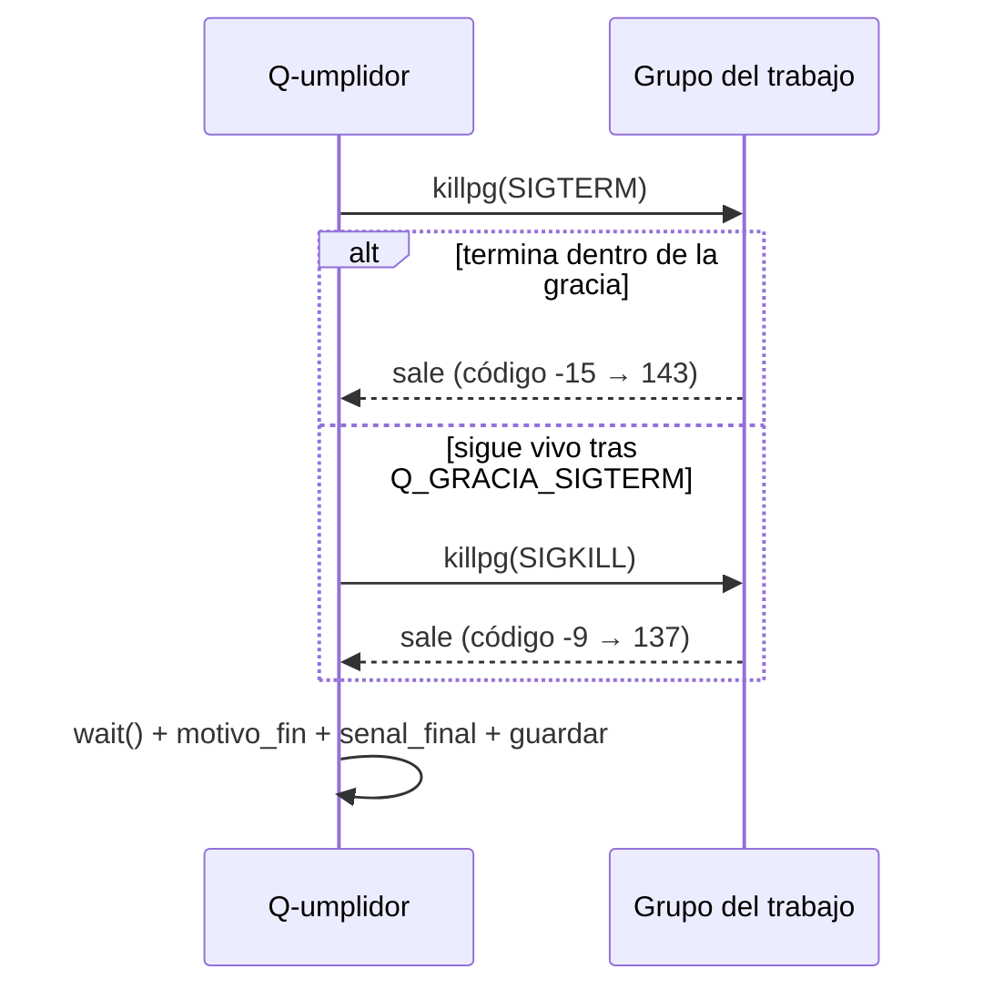
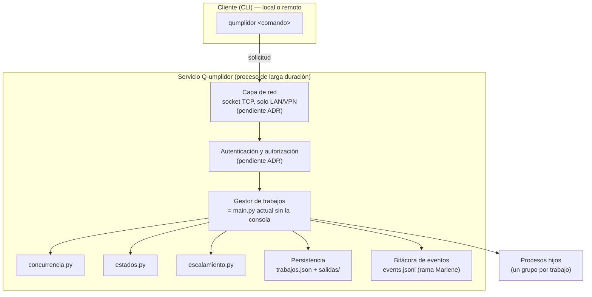

# Arquitectura del sistema: Q-umplidor (JobRunner)

> **Versión:** Avance 02. **Responsable:** Ruy.
> **Alcance:** describe la arquitectura **actual**, que es `main` más la rama `Ruy` (RF-05, RF-06, RF-30), y la arquitectura **objetivo** del producto final.
> Este documento es independiente de [Arquitectura.md](Arquitectura.md). Si algo de aquí no coincide con el código, manda el código.

## 1. Propósito y contexto

Q-umplidor es un gestor de trabajos para Linux. Recibe comandos, ejecuta cada trabajo como un proceso del sistema operativo y permite observarlo (estado, tiempos, salida, código), controlarlo (cancelar, limitar cuántos corren) y conservar su historial entre reinicios. El producto final también debe poder operarse de forma remota dentro de una LAN o VPN.



*Línea discontinua = todavía no implementado.*

## 2. Decisiones que gobiernan la arquitectura

| ADR | Decisión | Estado |
|---|---|---|
| [ADR-0001](../decisions/ADR-0001.md) | Python 3, solo biblioteca estándar | Aceptado |
| [ADR-0002](../decisions/ADR-0002.md) | Pool fijo de hilos | Reemplazado por ADR-0004 |
| [ADR-0003](../decisions/ADR-0003.md) | Persistencia (propuesta abierta) | Resuelto por ADR-0005 |
| [ADR-0004](../decisions/ADR-0004.md) | Despachador con límite de concurrencia configurable | Aceptado |
| [ADR-0005](../decisions/ADR-0005.md) | JSON con escritura atómica | Aceptado |
| [ADR-0006](../decisions/ADR-0006.md) | Recuperación al reiniciar y cierre ordenado | Aceptado |
| [ADR-0007](../decisions/ADR-0007.md) | Cancelación con escalamiento SIGTERM → SIGKILL | Aceptado |

## 3. Arquitectura actual

### 3.1 Módulos



| Módulo | Responsabilidad | Funciones principales |
|---|---|---|
| `main.py` | Consola interactiva, tabla de trabajos, lanzamiento de procesos, cola, despachador y persistencia | `lanzar_trabajo`, `registrar_trabajo`, `registrar_en_cola`, `despachar_cola`, `ejecutar_de_cola`, `lanzar_o_encolar`, `actualizar_trabajo`, `guardar_trabajos`, `cargar_trabajos` |
| `concurrencia.py` | Leer, validar y cambiar el límite; decidir si hay lugar | `leer_limite_concurrencia`, `ControlConcurrencia.hay_espacio`, `atender_comando_limite` |
| `estados.py` | Estados del cliente, regla del estado final, tiempos y presentación | `estado_cliente`, `estado_final`, `tiempo_espera`, `tiempo_ejecucion`, `detalle_estado`, `fila_listar` |
| `escalamiento.py` | Detener trabajos (SIGTERM → gracia → SIGKILL), tiempo máximo, cierre por señal | `terminar_con_escalamiento`, `detener_trabajo`, `iniciar_vigilante`, `instalar_cierre_por_senal` |

**Regla de dependencias:** `main.py` usa a los otros tres; ellos no conocen a `main.py`. Lo que necesitan del estado global (contar trabajos activos, listar los que están corriendo) lo reciben como funciones. Así cada módulo se puede leer y probar por separado.

### 3.2 Hilos

| Hilo | Cuántos | Qué hace | Termina cuando |
|---|---|---|---|
| Principal | 1 | Lee comandos, lanza trabajos con `&`, consulta, cancela | Ctrl+C, Ctrl+D, SIGTERM, SIGHUP |
| Despachador (`despachar_cola`) | 1 | Saca trabajos FIFO mientras haya lugar y anota el fin real de los trabajos con `&` | `cola_cerrandose` |
| Ejecutor (`ejecutar_de_cola`) | 1 por trabajo de la cola **en ejecución** (≤ límite) | `Popen` → `wait()` → registra el resultado | Termina su trabajo |
| Vigilante (`iniciar_vigilante`) | 0 o 1 | Detiene los trabajos que superan `Q_TIEMPO_MAXIMO` | Cierre (solo existe si `Q_TIEMPO_MAXIMO > 0`) |

**Sincronización:**
- `condicion_cola` (`threading.Condition`) protege la cola, `ids_arrancando` y la decisión "¿hay lugar? → lanzar".
- `bloqueo_guardado` serializa la escritura de `trabajos.json`.

### 3.3 Flujo de un trabajo



### 3.4 Modelo de estados

Internamente se guardan en español, por compatibilidad con historiales existentes, y se muestran con los nombres del cliente (RF-06).



| Interno | Cliente | Tiempos registrados |
|---|---|---|
| En cola | `QUEUED` | envío |
| En ejecución | `RUNNING` | envío, inicio |
| Terminado | `SUCCEEDED` | envío, inicio, fin |
| Falló (código N / tiempo máximo excedido) | `FAILED` | envío, inicio, fin |
| Cancelado | `CANCELED` | envío, (inicio), fin |
| Interrumpido | `INTERRUPTED` | envío, inicio, fin |

**Tiempos derivados:**
- espera = inicio − envío
- ejecución = fin − inicio

### 3.5 Detención de un trabajo (escalamiento)



La misma secuencia se usa para `cancelar`, para el tiempo máximo y para el cierre de Q-umplidor (normal, SIGTERM o SIGHUP).

### 3.6 Datos en disco

```
data/
├── trabajos.json        # siguiente_id + lista de trabajos (escritura atómica: .tmp + os.replace)
├── trabajos.tmp         # solo existe durante un guardado
└── salidas/
    ├── <id>.out         # stdout del trabajo
    └── <id>.err         # stderr del trabajo
```

Campos por trabajo: `id`, `comando`, `inicio`, `fin`, `estado`, `codigo`, `es_cola`, `segundos_solicitados`, `momento_encolado`, `argumentos_cola`, `motivo_fin`, `senal_final`.

### 3.7 Configuración

| Variable | Por defecto | Efecto | ADR |
|---|---|---|---|
| `Q_LIMITE_CONCURRENCIA` | 2 | Trabajos en `RUNNING` a la vez (también con `limite N`) | 0004 |
| `Q_GRACIA_SIGTERM` | 2 s | Espera entre SIGTERM y SIGKILL | 0007 |
| `Q_TIEMPO_MAXIMO` | 0 (sin límite) | Tiempo máximo en `RUNNING` | 0007 |
| `Q_CAPACIDAD_COLA` | 5 | Trabajos esperando en la cola (rama `Oscar-cola`) | — |

Un valor inválido detiene el arranque con un mensaje claro.

### 3.8 Comandos

| Comando | Componente |
|---|---|
| `sleep N &`, `ejecutar <prog> [args] &` | `lanzar_o_encolar` → `lanzar_trabajo` o `registrar_en_cola` |
| `queue <comando>`, `queue` | `registrar_en_cola`, `mostrar_cola` |
| `estado <id>`, `listar` | `actualizar_trabajo` + `estados.detalle_estado` / `fila_listar` |
| `codigo <id>`, `salida <id>`, `errores <id>` | Tabla de trabajos y `data/salidas/` |
| `cancelar <id>` | `escalamiento.detener_trabajo` |
| `limite [N]` | `concurrencia.atender_comando_limite` |
| `politica` | `escalamiento.mostrar_politica` |

### 3.9 Trazabilidad requisito → componente

| Requisito | Componente | ADR |
|---|---|---|
| RF-03 Cola | `registrar_en_cola`, `despachar_cola` | 0004 |
| RF-04 Ejecución sin bloquear | Procesos con `Popen`, hilos ejecutores | 0004 |
| RF-05 Límite de concurrencia | `concurrencia.py`, `contar_activos`, `lanzar_o_encolar` | 0004 |
| RF-06 Estados y tiempos | `estados.py`, `registrar_terminados` | 0004, 0005 |
| RF-10 Cancelación | `escalamiento.detener_trabajo` (+ cola en rama `Oscar-cola`) | 0007 |
| RF-11 stdout/stderr separados | `lanzar_trabajo`, `data/salidas/` | 0005 |
| RF-12 / RF-13 Persistencia y recuperación | `guardar_trabajos`, `cargar_trabajos` | 0005, 0006 |
| RF-30 Escalamiento | `escalamiento.py` | 0007 |

## 4. Arquitectura objetivo (producto final)

> Esta sección es una **propuesta**. Las piezas marcadas como pendientes necesitan su propio ADR antes de implementarse.

### 4.1 Separar servicio y cliente

Hoy la consola y el gestor viven en el mismo proceso, así que si se cierra la consola se detienen los trabajos. Para operar desde la LAN o VPN, el producto final separa:



### 4.2 Qué se conserva y qué cambia

| Pieza | En el producto final |
|---|---|
| `concurrencia.py`, `estados.py`, `escalamiento.py` | Se conservan tal cual. No dependen de la consola. |
| Persistencia y recuperación | Se conservan. La recuperación (ADR-0006) cobra más importancia porque el servicio corre por más tiempo. |
| Ciclo `while True` con `input()` | Se reemplaza por un ciclo que atiende solicitudes de la red. Cada comando actual pasa a ser una operación del protocolo. |
| Cierre por SIGTERM | Es el apagado normal del servicio (por ejemplo, desde systemd). |

### 4.3 Decisiones pendientes

| Tema | Preguntas a resolver |
|---|---|
| Protocolo de red | ¿Socket TCP con mensajes JSON por línea, o HTTP? ¿Qué operaciones y qué formato de error? |
| Acceso LAN/VPN | ¿En qué interfaz escucha? ¿Cómo se rechazan conexiones de fuera de la red privada? |
| Autenticación | ¿Token compartido o usuario/contraseña? ¿Cómo se guarda el secreto? |
| Saturación | Qué pasa cuando se llena la cola (RF-25, rama `Oscar-cola`) o llegan muchas conexiones. |
| Solicitudes duplicadas | RF-26 (rama `Marlene`). |
| Huérfanos tras SIGKILL al servicio | Guardar PID + hora de inicio y limpiar al reiniciar (ADR-0006). |

## 5. Estado de integración

| Rama | Contenido | Relación con esta arquitectura |
|---|---|---|
| `main` | Base del Avance 01 + cola + persistencia | Base de este documento |
| `Ruy` | RF-05, RF-06, RF-30 + ADR-0004 a ADR-0007 | Descrita aquí como "actual" |
| `Oscar-cola` | Cancelar en cola, capacidad de cola, alias `queue cancelar` | Combinada con `Ruy`, tiene 1 conflicto de una línea en `cancelar`: se conserva `id_trabajo in ids_arrancando`. Probada en conjunto. |
| `Marlene` | Bitácora de eventos, duplicados | Ya choca con `main` sin contar `Ruy`. Su `finalizar_trabajo` debe usar `estados.estado_final()`. |
