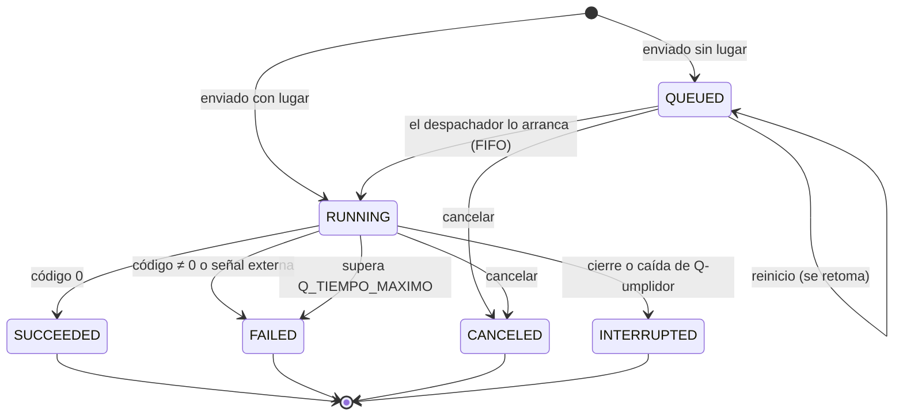

# Modelo de estados de un trabajo

> **Versión:** Avance 02. **Responsable:** Ruy Valle.
> Describe lo que hace el código. Los estados se calculan en `src/estados.py` (`estado_cliente`, `estado_final`), y la recuperación está en `src/recuperacion.py`.

## 1. Propósito

Definir en qué estados puede estar un trabajo, qué evento provoca cada cambio y qué tiempos se registran. Este modelo lo usan `estado`, `listar`, `queue`, `codigo` y `cancelar`, y la recuperación al reiniciar.

## 2. Estados

El código guarda el estado en español en `data/trabajos.json`, por compatibilidad con historiales anteriores. Al mostrarlo lo traduce al nombre que pide el cliente (RF-06).

| Estado (cliente) | Interno | Significado | Código de salida |
|---|---|---|---|
| `QUEUED` | En cola | Espera lugar: se alcanzó el límite de concurrencia o se envió con `queue` | No tiene |
| `RUNNING` | En ejecución | Su proceso existe y Q-umplidor lo supervisa | No tiene |
| `SUCCEEDED` | Terminado | El proceso terminó con código 0 | `0` |
| `FAILED` | Falló (código N) | Terminó con código ≠ 0, o lo mató una señal externa | `1`–`255`, o 137/143 si fue una señal |
| `FAILED` | Falló (tiempo máximo excedido) | La política lo detuvo por superar `Q_TIEMPO_MAXIMO` | 143 o 137 |
| `CANCELED` | Cancelado | El usuario lo canceló, en cola o en ejecución | Sin código si estaba en cola; 143/137 si corría |
| `INTERRUPTED` | Interrumpido | Q-umplidor se cerró o se cayó mientras corría | El que tenía al detenerse, si se conoce |

## 3. Diagrama

## 4. Transiciones

| De | A | Evento | Dónde |
|---|---|---|---|
| (inicio) | `RUNNING` | `sleep N &` o `ejecutar ... &` con lugar libre | `lanzar_o_encolar` |
| (inicio) | `QUEUED` | `queue <cmd>`, o `&` con el límite lleno | `registrar_en_cola` |
| (inicio) | — (rechazo) | La cola llegó a `Q_CAPACIDAD_COLA`: no se registra ni consume ID | `registrar_en_cola` |
| `QUEUED` | `RUNNING` | Hay lugar (activos < límite) y es el primero de la cola | `despachar_cola` |
| `QUEUED` | `CANCELED` | `cancelar <id>`: se retira de la cola bajo `condicion_cola` | `cancelar` |
| `RUNNING` | `SUCCEEDED` / `FAILED` | El proceso termina | `estado_final` |
| `RUNNING` | `CANCELED` | `cancelar <id>`: SIGTERM → gracia → SIGKILL al grupo | `escalamiento.detener_trabajo` |
| `RUNNING` | `FAILED` | Supera `Q_TIEMPO_MAXIMO`; misma política | `escalamiento.iniciar_vigilante` |
| `RUNNING` | `INTERRUPTED` | Cierre normal, SIGTERM o SIGHUP: escalamiento y luego se marca | Cierre en `main.py` |
| `RUNNING` | `INTERRUPTED` | Caída (`kill -9`): al reiniciar se detiene el huérfano si sigue vivo y luego se marca | `recuperacion.recuperar_trabajos` |
| `QUEUED` | `QUEUED` | Reinicio: se vuelve a poner en la cola en su orden | Arranque en `main.py` |

## 5. Reglas del modelo (invariantes)

1. Solo se avanza: no hay regreso desde un estado final.
2. `SUCCEEDED`, `FAILED`, `CANCELED` e `INTERRUPTED` son **finales**.
3. **Ningún trabajo se reporta `RUNNING` sin un proceso que lo respalde.** Un hilo recolector (`recolectar_terminados`) revisa los procesos cada 0.5 s, y cada trabajo de la cola tiene además un hilo que espera su proceso.
4. **Ningún trabajo se reporta `INTERRUPTED` con su proceso vivo.** Al reiniciar, si el proceso sigue vivo (misma huella), primero se detiene ([INC-002](../incidents/INC-002.md)).
5. `CANCELED` solo ocurre si el usuario lo pidió. Una señal externa o el tiempo máximo dan `FAILED`.
6. Un estado final se decide en un solo lugar, `estados.estado_final()`, para que todos los caminos den el mismo resultado.
7. El código de salida existe solo si el proceso llegó a ejecutarse y terminó. `codigo` muestra las señales como Bash: 128 + señal.

## 6. Tiempos

| Campo | Cuándo se fija |
|---|---|
| Envío | Al aceptar el trabajo (`momento_encolado`, o `inicio` si arrancó directo) |
| Inicio | Al crear el proceso |
| Fin | Al terminar, cancelarse o interrumpirse; con precisión de 0.5 s (hilo recolector) |
| Espera | inicio − envío (tiempo en `QUEUED`) |
| Ejecución | fin − inicio (tiempo en `RUNNING`) |

Invariante: envío ≤ inicio ≤ fin. Se verifica en TC-021.

## 7. Verificación

| Regla o transición | Caso |
|---|---|
| Límite y `QUEUED` → `RUNNING` en orden FIFO | TC-020 |
| Los 4 estados finales y los tiempos | TC-021 |
| `CANCELED` con escalamiento, sin huérfanos | TC-022 |
| `FAILED` por tiempo máximo | TC-023 |
| `FAILED` por señal externa, sin zombis | TC-024 |
| Regla 4 tras `kill -9`; `QUEUED` retomado | TC-025 |
| `INTERRUPTED` por SIGTERM/SIGHUP | TC-026 |
| Rechazo con la cola llena | TC-027 |
